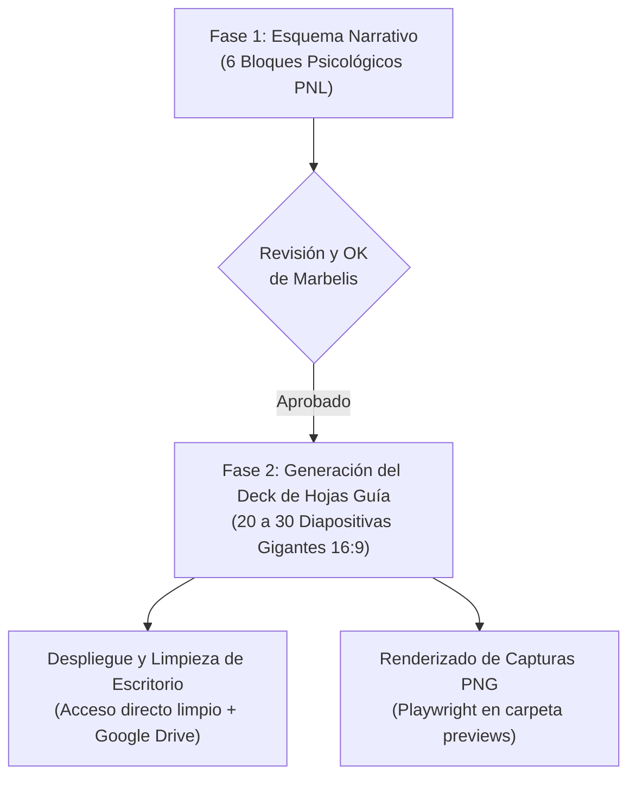

# 🎙️ Skill Oficial: Video Podcast y Hojas Guía a Cámara — RealMente (Marbelis Montero)

Esta skill establece el **estándar definitivo y oficial de producción y grabación de video podcasts** para **Marbelis Montero** (Master Trainer en PNL). Consolida el nuevo esquema de trabajo de grabación orgánica frente a cámara («de corrido»), eliminando la lectura rígida de guiones de audio y sustituyéndola por **Hojas Guía visuales en diapositivas gigantes**.

> [!IMPORTANT]
> **Consagrado Oficialmente en el Episodio #64:**  
> *"Este va a ser el nuevo esquema de trabajo: preparar el esquema, y cuando le damos okay, hacer este tipo de diapositivas que son bastante grandes para yo poder guiarme y pasarlas a lo largo del podcast. Guarda esta información para volverlo a utilizar y preparar de ahora en adelante los episodios de ese modo."* — Marbelis Montero.

---

## 🎯 1. Filosofía de Grabación a Cámara (Orgánica y en un Solo Tiro)

1. **El Formato Físico de Grabación:**
   * **Cámara / Celular:** Grabación con smartphone sobre trípode o asistida por una persona, a la altura de los ojos.
   * **Laptop en mesa de apoyo:** Colocada frente a Marbelis sobre la mesa o escritorio, sirviendo como monitor de apoyo a una distancia de 60 cm a 1.2 m.
   * **Cero lectura forzada:** No se lee texto continuo. La facilitadora baja la vista medio segundo, absorbe 4 a 8 palabras gigantes, levanta la mirada al lente y habla con espontaneidad y calidez. Esto proyecta máxima autoridad y naturalidad de mentora.

2. **La Regla de Oro: Evitar Entrecerrar los Ojos o Arrugar la Cara:**
   * ⛔ **PROHIBIDO:** 
     * Subtítulos pequeños, notas explicativas o párrafos largos (formato tipo Word).
     * Cuadritos comparativos de colores (rojo / turquesa / verde) con viñetas interiores densas.
     * Cualquier elemento tipográfico menor a `2rem` (32px) en el cuerpo central.
   * ✅ **OBLIGATORIO: MODO TÍTULO ABSOLUTO:**
     * **Cada diapositiva es UNA SOLA frase o idea fuerza.**
     * **Tipografía gigante:** `font-size: clamp(2.3rem, 4.4vw, 4.2rem)` (45px a 65px).
     * Centrada en pantalla, alto contraste, con palabras clave resaltadas en turquesa (`#00f2fe`) o lila (`#d8b4fe`).

---

## 🧭 2. El Flujo de Trabajo Oficial en 2 Fases

Para cada nuevo episodio se sigue estrictamente este ciclo:

---

### FASE 1: Esquema Narrativo y Aprobación
Antes de generar láminas, se maqueta la arquitectura psicológica del episodio estructurada en 6 bloques obligatorios:

1. **Bloque 1: Apertura & Gancho Visceral (00:00 - 02:00):**
   * Frase tradicional de inicio: *«Sean todos bienvenidos a un nuevo episodio de tu podcast RealMente»*.
   * El espejo visceral (confrontación inmediata del dolor o contradicción cotidiana).
   * Promesa de retención (*«Quédate hasta el final...»*).
   * Llamado orgánico a dar *like*, suscribirse y compartir.
2. **Bloque 2: El Espejo Cotidiano y el Costo Biológico (02:00 - 05:00):**
   * Ejemplo de la vida real (contraste claro entre compromiso externo vs. abandono interno).
   * La trampa de *"nadie me ve"*.
   * La verdad neurobiológica de la PNL (lo que graba el inconsciente y el sistema nervioso).
3. **Bloque 3: Las 3 Trampas Inconscientes del Sabotaje (05:00 - 09:00):**
   * Desglose de los 3 mecanismos que alimentan al verdugo o al freno de mano.
4. **Bloque 4: El Giro de Identidad (09:00 - 12:00):**
   * Redefinición profunda: lo que NO es (perfección robótica) vs. lo que SÍ es.
   * La metáfora entrañable de Marbelis (la niña con las rodillas raspadas, la aliada incondicional, la casa sólida).
   * Axioma de contención (*«No te pidas perfección; pídete presencia»*).
5. **Bloque 5: Protocolo Práctico de PNL (12:00 - 15:00):**
   * 3 a 4 pasos simples y cotidianos (acuerdo mínimo viable, dopamina limpia, reencuadre del tropiezo).
6. **Bloque 6: Pregunta de Poder & Cierre Potenciado (15:00 - 18:00):**
   * Pregunta visceral para la libreta personal (pausa a cámara).
   * Llamado a comentar en YouTube para mover el algoritmo y responder personalmente.
   * Invitación al **RealMente Club** (mención de la hoja de trabajo semanal y la clase por Zoom).
   * Ancla somática (*«Yo puedo, he podido y podré; y tú también has podido, puedes y podrás»*).
   * Respiración, sonrisa y despedida: *«¡Bye, bye!»*.

---

### FASE 2: Generación del Deck de Hojas Guía Gigantes (16:9)

Una vez que Marbelis da el visto bueno al esquema, se genera el archivo interactivo `presentacion_episodio_[N].html`:

* **Volumen:** De **20 a 30 diapositivas** individuales.
* **Diseño y Paleta:**
  * Fondo morado oscuro berenjena (`#0a0412` con degradado radial `#1f0c38`).
  * Luz suave que no encandila ni crea reflejos blancos en el rostro frente al celular.
  * Texto en blanco puro (`#ffffff`) con palabras clave en turquesa brillante (`#00f2fe`) y lila (`#d8b4fe`).
* **Navegación Intuitiva de 1 Dedo:**
  * Tecla **`Espacio`** o flecha **`→`** para avanzar la siguiente frase.
  * Tecla **`←`** para retroceder.
  * Tecla **`F`** para pantalla completa instantánea.
  * Botones grandes y contador visible en píldora superior (`01 / 27`).

---

## 📁 3. Protocolo de Escritorio y Distribución Automática

Para garantizar que Marbelis tenga acceso inmediato y sin fricción al momento de grabar:

1. **Limpieza del Escritorio de Windows:**
   * Eliminar accesos, ejecutables `.bat`, presentaciones y archivos temporales de episodios anteriores (`CLASE_SABADO_EP[anterior]`, hojas viejas).
2. **Creación del Acceso Directo de Rodaje:**
   * Crear en `$env:USERPROFILE\Desktop` el acceso directo:
     `PRESENTACION_EPISODIO_[N].url`
   * Con icono directo al navegador predeterminado.
3. **Respaldo en Google Drive:**
   * Sincronizar automáticamente el archivo HTML a:
     `G:\Mi unidad\MARCA\Episodios\EP[N]_[Nombre]\04_Club_Ejercicio_y_Diapositivas\presentacion_episodio_[N].html`
4. **Renderizado de Capturas (Playwright):**
   * Ejecutar el script `render_slides_ep[N].py` para generar las imágenes PNG individuales de todas las láminas gigantes en la carpeta `previews/`.
5. **Lanzamiento Inmediato:**
   * Ejecutar `Start-Process` para que la presentación se abra en pantalla frente a sus ojos al finalizar.
