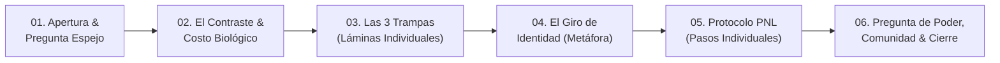

# 🎙️ Skill Oficial: Grabación de Video Podcast en Modo Disparadores de Ideas — RealMente

**Host y Mentora:** Marbelis Montero (Master Trainer en PNL)  
**Ecosistema:** RealMente Podcast & RealMente Club  
**Consagrado Oficialmente:** Episodio #64 («RealMente estar de tu lado: el arte de no volverte a fallar»)

Esta skill establece la **metodología definitiva de conceptualización, esquematización y maquetación de presentaciones guía a cámara** para todos los episodios del video podcast de Marbelis Montero.

---

## 🧠 1. Filosofía: El Fin de la Lectura Rígida y el Nacimiento de los Disparadores

### El problema identificado en el EP64:
Cuando el guion se presenta como un discurso continuo fraccionado en oraciones (modo teleprompter tradicional), ocurre un bloqueo cognitivo:
1. Si Marbelis aparta la mirada un segundo de la pantalla o parpadea, **pierde el hilo de qué estaba leyendo**.
2. Los microejemplos escritos textualmente (ej. *"Cita de trabajo a las 8:00 AM: llegas a las 7:55 AM..."*) obligan a leer literalmente en lugar de hablar desde la experiencia.
3. Se pierde la calidez, la autoridad y el contacto visual genuino con la audiencia.

### La solución oficial: El Modo Disparadores de Ideas
Marbelis **no lee guiones: facilita y mentoriza desde la PNL**. Su mente ya conoce los conceptos, las metáforas y la estructura. Por lo tanto, la pantalla de su laptop funciona únicamente como un **faro o brújula visual**:
* La diapositiva le entrega el **inicio conceptual o título disparador**.
* Marbelis absorbe la idea en medio segundo, mira directamente al lente del celular/cámara y **desarrolla la idea con sus propias palabras, anécdotas y tono entrañable**.

---

## 🚫 2. Reglas de Oro Visuales: Prohibiciones y Obligaciones

### ⛔ PROHIBICIONES ESTRICTAS (Cero Contaminación Visual):
1. **CERO SUBTÍTULOS:** Queda terminantemente prohibido colocar subtítulos explicativos, oraciones secundarias o aclaraciones debajo del título en la lámina.
2. **CERO PÁRRAFOS O VIÑETAS DENSAS:** No se colocan listas de viñetas agrupadas en una misma lámina.
3. **CERO CUADROS DE COLORES O TABLAS:** No usar cajas tipo Word, tarjetas divididas o tablas comparativas que obliguen a fijar la vista y entrecerrar los ojos.

### ✅ OBLIGACIONES DE DISEÑO (Lámina Limpia y Contundente):
Cada lámina interactiva debe tener **única y exclusivamente**:
1. **Insignia Temática Superior (`topic-badge`):**  
   Píldora pequeña y elegante que sitúa el bloque mental (ej. `LA GRAN PREGUNTA`, `EL CONTRASTE`, `TRAMPA 01`, `PASO 01`, `DEFINICIÓN REAL`).
2. **UN SOLO TÍTULO GIGANTE Y CENTRADO (`giant-title`):**  
   * Tipografía sans-serif de alto impacto (`Outfit`, peso 800/900).
   * Tamaño responsivo grande: `font-size: clamp(2.4rem, 4.8vw, 4.4rem)`.
   * Máximo contraste sobre fondo morado oscuro berenjena (`#0a0412` con degradado radial `#240c42`).
   * Palabras clave resaltadas en:
     * **Turquesa Neón (`#00f2fe`):** Conceptos de avance, PNL, soluciones y autoconfianza.
     * **Oro Cálido (`#fde047`):** Énfasis de dolor, trampas o confrontación amorosa.
     * **Lila Suave (`#d8b4fe`):** Anclajes emocionales e identidad.
3. **Frases Célebres o Preguntas de Poder:**  
   Tipografía con serif elegante (`Playfair Display`, estilo itálico) para citas y preguntas viscerales a cámara.

---

## 🧩 3. Regla Pedagógica de Desglose Individual (Listas y Pasos)

Nunca se resume una lista de elementos en una sola lámina. Se aplica el **desglose individual**:

### Ejemplo: Las 3 Trampas del Autosabotaje
* **Lámina de Entrada:**  
  * Insignia: `PATRONES INCONSCIENTES`  
  * Título: **Las 3 trampas del autosabotaje**  
  *(Marbelis abre la sección explicando que caer en esto responde a patrones inconscientes).*
* **Lámina Trampa 1:**  
  * Insignia: `TRAMPA 01`  
  * Título: **El «Todo o Nada»: Querer pasar de 0 a 100 en un solo día**  
  *(Marbelis desarrolla libremente el perfeccionismo y el verdugo interior).*
* **Lámina Trampa 2:**  
  * Insignia: `TRAMPA 02`  
  * Título: **El Contrato de Castigo: Creer que con látigo se avanza**  
  *(Marbelis explica el agotamiento de la dopamina y la subida de cortisol).*
* **Lámina Trampa 3:**  
  * Insignia: `TRAMPA 03`  
  * Título: **Complacer para Pertenecer: Decirle «sí» a todos diciéndote «no» a ti**  
  *(Marbelis habla de los límites y el miedo al juicio ajeno).*

*(La misma regla aplica para los 3 o 4 pasos prácticos de PNL: una lámina introductoria general seguida de 1 lámina individual por cada paso).*

---

## 🏛️ 4. Arquitectura Narrativa Estándar en 6 Bloques

Todos los episodios deben estructurarse en torno a esta secuencia de ~22 a 28 diapositivas:



1. **Bloque 1: Apertura & Pregunta Espejo**
   * Lámina 1: Bienvenida al podcast RealMente.
   * Lámina 2: Título oficial del episodio.
   * Lámina 3: La gran pregunta visceral (*«¿Por qué le cumples al mundo entero... y a ti te dejas para después?»*).
   * Lámina 4: Llamado a la comunidad (like, suscribirse, compartir).
2. **Bloque 2: El Contraste Cotidiano y el Costo Biológico**
   * Lámina 5: El contraste de la vida real (ej. puntual afuera a las 8 AM vs. cancelarte en 1 minuto adentro).
   * Lámina 6: El registro de la mente inconsciente (SÍ te está mirando).
   * Lámina 7: Diagnóstico de identidad (la cuenta de autoconfianza en números rojos).
3. **Bloque 3: Las 3 Trampas Inconscientes**
   * Lámina 8: Introducción a las 3 trampas.
   * Láminas 9, 10, 11: Trampas 1, 2 y 3 individuales con sus títulos disparadores.
4. **Bloque 4: El Giro de Identidad**
   * Lámina 12: Lo que NO es (no es ser un robot perfecto).
   * Lámina 13: Definición real (no declararte la guerra cuando algo sale mal).
   * Lámina 14: Metáfora entrañable de Marbelis (bálsamo afuera vs. tribunal de fusilamiento adentro / la niña con las rodillas raspadas).
   * Lámina 15: Axioma o principio guía (*«No te pidas perfección; pídete presencia y contención»*).
5. **Bloque 5: Protocolo Práctico de Microacuerdos (PNL)**
   * Lámina 16: Introducción al protocolo de pasos.
   * Láminas 17 a 20: Pasos 1 al 4 individuales (Acuerdo mínimo viable, Sagralidad, Fisiología de victoria, Cero látigo ante el tropiezo).
6. **Bloque 6: Preguntas de Poder, Comunidad y Cierre con Amor**
   * Lámina 21: Pregunta de poder para la libreta.
   * Lámina 22: Pregunta de microacuerdo para HOY.
   * Lámina 23: Llamado a comentar en YouTube.
   * Lámina 24: Invitación oficial a **RealMente Club** (hoja de trabajo semanal y sesión en vivo de Zoom).
   * Lámina 25: Frase ancla oficial: *«Yo puedo, he podido y podré; y tú también has podido, puedes y podrás»*.
   * Lámina 26: Despedida somática: *Inhala profundo... exhala... sonríe... ¡Bye, bye!*

---

## 💻 5. Especificaciones Técnicas del Archivo HTML

El archivo interactivo `PRESENTACION_EPISODIO_[N].html` debe cumplir con los siguientes estándares de código:

* **Fuentes Web:** Google Fonts `Outfit` (pesos 400, 600, 700, 800, 900) y `Playfair Display` (700 itálica).
* **Navegación Ergonómica de Grabación:**
  * **Barra Espaciadora / Flecha Derecha (`→`) / Enter:** Avanzar a la siguiente lámina.
  * **Flecha Izquierda (`←`) / Backspace:** Retroceder a la lámina anterior.
  * **Clic en cualquier parte de la pantalla:** Avanzar lámina (facilita tocar el trackpad o ratón sin mirar).
  * **Tecla `F`:** Activar/desactivar pantalla completa instantáneamente.
  * **Tecla `Home` / `End`:** Ir al inicio o fin.
* **Barra Superior:**
  * Nombre del episodio y badge de modo (`RealMente #[N] • DISPARADORES`).
  * Contador gigante en píldora (`01 / 26`).
  * Botón de Pantalla Completa.
* **Transiciones:** Suavizadas con `opacity` y `transform: scale(0.97)` para que el cambio de lámina no genere parpadeos bruscos en la iluminación del rostro.

---

## 🚀 6. Protocolo de Despliegue en Escritorio y Respaldo

Cada vez que se complete la preparación de un nuevo episodio bajo esta metodología:

1. **Entrega Limpia en el Escritorio de Windows:**
   * Guardar directamente en `$env:USERPROFILE\Desktop`:
     * `PRESENTACION_EPISODIO_[N].html`
     * `ESQUEMA_EPISODIO_[N].md`
   * **Limpieza:** Eliminar del Escritorio cualquier versión antigua o borrador previo para que Marbelis solo vea el archivo definitivo.
2. **Estructura del Proyecto Local:**
   * Guardar en: `c:\Users\soyma\OneDrive\Documents\ANTIGRAVITY\MARCA\Episodios\EP[N]_[Nombre]\02_Podcast_Guion_y_Grabacion\`:
     * `presentacion_episodio_[N].html`
     * `esquema_episodio_[N].md`
3. **Respaldo Automático en GitHub:**
   * Ejecutar inmediatamente:
     ```bash
     python github_helper.py push --repo realmente-marca
     ```
   * Garantizar que el repositorio `realmente-marca` quede 100% sincronizado con el nuevo episodio.
