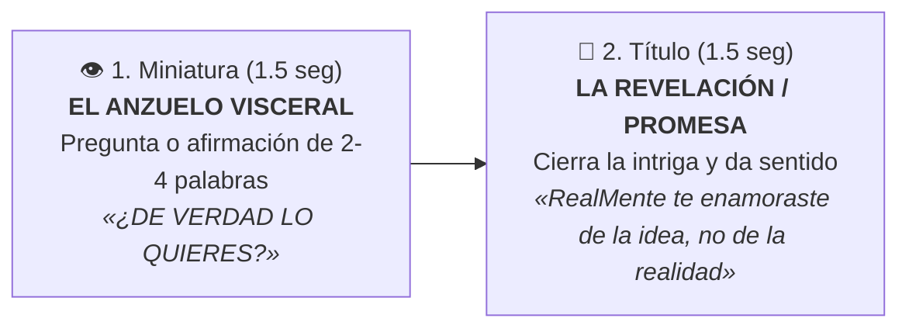

# 🎯 Skill Oficial: Títulos y Miniaturas de Alto Impacto — RealMente

**Host y Mentora:** Marbelis Montero (Master Trainer en PNL)  
**Canal:** RealMente Podcast (YouTube / Spotify Video)  
**Consagrado Oficialmente:** Episodio #66 (*«RealMente te enamoraste de la idea, no de la realidad»* | Miniatura: *«¿DE VERDAD LO QUIERES?»*)

Esta skill estandariza la metodología psicológica, lingüística y visual para concebir los **títulos de YouTube y los textos ancla de miniaturas** antes de grabar cada episodio, garantizando que ambos elementos trabajen en sinergia para captar clics y sintonizar la energía de Marbelis frente a cámara.

---

## 🚫 1. Regla de Oro: La Política Anti-Aburrimiento (Cero Lenguaje Corporativo)

El público de RealMente busca transformación emocional, autoconocimiento profundo y alivio de la culpa, no una clase de administración ni un sermón de autoayuda genérica.

### ⛔ TÉRMINOS PROHIBIDOS EN TÍTULOS:
* **«Objetivos» / «Metas»:** Suenan a oficina, fin de año corporativo, KPIs o tareas escolares aburridas.
* **«Productividad» / «Gestión del tiempo»:** Desvían el foco hacia el rendimiento mecánico y la autoexigencia tóxica.
* **«Tomar acción» / «Accionar»:** Cliche de marketing que reduce la complejidad humana a "echarle ganas".
* **«Cómo lograr...»:** Fórmula trillada de tutorial que no genera resonancia visceral.

### ✅ CONCEPTOS MAGNÉTICOS QUE SÍ ACTIVAN EL CLIC:
* **La revelación del autoengaño:** Descubrir por qué creías algo que en realidad no es así.
* **El alivio de la culpa:** Quitarle a la mujer el peso de creer que es "inconstante" o que "le falta fuerza de voluntad".
* **La confrontación amorosa:** Preguntas directas al pecho que incomodan con ternura.
* **La trampa de la mente:** Exponer cómo el inconsciente y la mente creativa crean ilusiones seguras para no arriesgarse.

---

## ⚡ 2. La Sinergia Indisoluble: Título + Miniatura (El Dúo de 3 Segundos)

El espectador en YouTube decide si entra en tu video en menos de **3 segundos**. La miniatura y el título **NUNCA deben decir lo mismo**: funcionan como una pinza psicológica de dos tiempos.

### Reglas para la Miniatura:
1. **Máximo 2 a 4 palabras:** Debe leerse al instante en una pantalla de teléfono celular de 5 pulgadas.
2. **Formato:** Pregunta directa o declaración lapidaria (ej. *«¿POR QUÉ TE FALLAS?»*, *«¿DE VERDAD LO QUIERES?»*, *«NO QUIERES ESO»*).
3. **Alto Contraste Visual:** Tipografía pesada (`Jost` 900 o similar), en colores oficiales (`#ffffff`, acento `#fde047` amarillo oro o `#00f2fe` turquesa), sobre fondo oscuro berenjena.
4. **Gesto de Marbelis:** La expresión facial debe coincidir con la pregunta (mirada de complicidad, ceño leve de duda reflexiva, o calma de mentora que sabe la verdad).

### Reglas para el Título de YouTube:
1. **Sello de Marca:** Iniciar obligatoriamente con la palabra **`RealMente`** (con la M mayúscula).
2. **Longitud Estricta:** Entre **52 y 61 caracteres** (incluyendo espacios). Si supera los 62 caracteres, YouTube corta el final con puntos suspensivos (...) en dispositivos móviles.
3. **Estructura Narrativa:** `RealMente [Afirmación o Paradoja]: [Giro de Tuerca o Revelación]`.

---

## 🎙️ 3. Sintonización Somática: Definir el Título ANTES de Grabar

El título y la miniatura no son un trámite de postproducción: **son la brújula energética del rodaje**.

Antes de pulsar el botón de grabación en su set, Marbelis debe leer la pareja Título + Miniatura para instalar en su cuerpo la **postura somática y emocional** adecuada:
* Si la miniatura dice *«¿DE VERDAD LO QUIERES?»*, Marbelis se sienta frente al lente no como una profesora que va a dictar clase, sino como la amiga sabia que te sirve un té, te mira fijamente y te invita a ser honesta contigo misma.
* La frase de la miniatura se convierte en el ancla mental del episodio, permitiendo que las anécdotas y metáforas fluyan de forma orgánica.

---

## 📋 4. Ejemplos de Éxito en RealMente

| Ep. | Título Oficial (52-61 chars) | Chars | Texto Miniatura (2-4 palabras) | Energía Somática de Grabación |
|---|---|---|---|---|
| **#64** | `RealMente estar de tu lado: el arte de no volverte a fallar` | 58 | **«¿POR QUÉ TE FALLAS?»** | Firmeza amorosa, desmontar la lealtad externa. |
| **#65** | `Realmente cambiar sin romperte: los pasos previos a la coherencia` | 66 | **«NO TE ATROPELLES»** | Regulación somática, compasión con tu etapa. |
| **#66** | `RealMente te enamoraste de la idea, no de la realidad` | 56 | **«¿DE VERDAD LO QUIERES?»** | Revelación liberadora, romper el mito del sueño mental. |

---

## 🔍 5. Checklist para Aprobar Nuevos Títulos

Antes de dar por aprobado el título de cualquier episodio futuro (#67 al #73), responder a estas 4 preguntas:

- [ ] ¿Empieza con `RealMente` y tiene entre 52 y 61 caracteres?
- [ ] ¿Está completamente libre de palabras secas como "objetivo", "meta", "productividad" o "accionar"?
- [ ] ¿Tiene una frase de miniatura de 2 a 4 palabras que genere intriga instantánea en móvil?
- [ ] ¿Le transmite a Marbelis una emoción clara y potente para sentarse a hablar a cámara con naturalidad?
