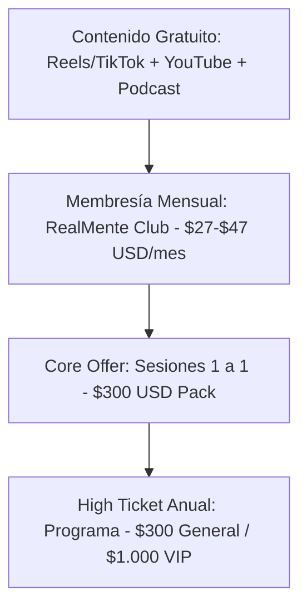

# Informe Estratégico de Posicionamiento y Nicho Perfecto
**Preparado para:** Marbelis Montero (Real Mente Podcast)  
**Fecha:** Mayo 2026  
**Objetivo:** Definir tu nicho de mercado ideal, analizar tus referentes de inspiración, estructurar tu escalera de valor (incluyendo tu membresía) y trazar tu plan de contenidos para Instagram, YouTube y TikTok partiendo de que estás iniciando en el mercado de habla hispana.

---

## 1. Definición de tu Nicho Perfecto

> [!IMPORTANT]
> Al estar iniciando, intentar hablarle a "todo el mundo" sobre "crecimiento personal" es el error más común y costoso. Necesitas especializarte en un dolor muy específico y resolverlo con tu método único (PNL + Hipnosis + Rigor Neuro-científico).

Basándonos en tus temas (mentalidad de éxito, reprogramación mental, hipnosis) y tu tono de voz de **Mentora de Transformación Profunda e Inconsciente (Amorosamente Directa / "Cachetada de Realidad")**, te sugiero el siguiente nicho estratégico:

### **El Nicho Propuesto:**
> **"Reprogramación del Inconsciente y Mentalidad de Impacto para Emprendedores y Profesionales que sufren de Autosabotaje y Síndrome del Impostor."**

#### **¿Por qué este es tu Nicho Perfecto?**
1.  **Conexión entre Ciencia y Acción:** Los emprendedores y profesionales no quieren misticismo etéreo; valoran entender el cerebro (rutas neuronales, sistema predictivo) y quieren herramientas rápidas de aplicar (hipnosis y PNL).
2.  **Soluciona un Dolor de Alto Costo (El Autosabotaje):** El autosabotaje les cuesta dinero real, proyectos perdidos y estrés constante. Están dispuestos a pagar tickets altos ($300 - $1.000 USD) para solucionarlo rápido.
3.  **Encaja con tu Voz:** Tu estilo contundente, irónico y humorístico es el antídoto ideal contra el autosabotaje. La persona que se autosabotea necesita una mentora que le diga las cosas como son, sin rodeos, pero con la cercanía de una amiga.

---

## 2. Tus Referentes vs. Tu Propuesta Única

Has identificado a **Tony Robbins** y **Margarita Pasos** como tus mayores referentes. Aquí te muestro cómo te posicionas frente a ellos:

*   **Tony Robbins (El Showman de Alta Energía):**
    *   *Su estilo:* Cambios de estado inmediatos, gritos, saltos, show masivo de motivación americana.
    *   *Tu diferenciador:* En lugar de la adrenalina grupal que suele desvanecerse a los pocos días, tú trabajas con la **reprogramación profunda del inconsciente y la hipnosis clínica**, permitiendo cambios silenciosos y duraderos. Tu formato es el "chismecito" íntimo y la vulnerabilidad, no el show de estadio.
*   **Margarita Pasos (La Entrenadora de Ventas y Rendimiento):**
    *   *Su estilo:* Motivación pura de negocios, resiliencia y técnicas B2B ("Yo pude, tú puedes").
    *   *Tu diferenciador:* Margarita se enfoca en el rendimiento comercial visible. Tú vas más profundo a la **decodificación emocional del trauma y el inconsciente familiar**. Explicas el trasfondo neurobiológico detrás de por qué alguien no logra vender o avanzar, en lugar de solo enseñarle técnicas de venta.

---

## 3. Optimización de tu Escalera de Valor y Membresía

Con tu oferta actual estructurada, podemos construir un embudo de ventas que genere ingresos recurrentes y estables:

### **A. Estructura de tu Membresía (Ingresos Recurrentes):**
*   **Concepto:** *Gimnasio de Reprogramación Mental RealMente*.
*   **Precio Sugerido:** **$27 - $39 USD/mes** (un precio de entrada bajo que facilita que se unan decenas o cientos de personas).
*   **¿Qué incluye cada mes?**
    1.  *1 Sesión de Reprogramación en Vivo:* Una sesión grupal de hipnosis o ejercicio práctico de PNL enfocado en un tema mensual (Ej: Dinero, Síndrome del Impostor, Relación con los Límites).
    2.  *1 Audio de Autohipnosis de 10 min:* Un archivo descargable de alta calidad diseñado para escuchar por las noches para reprogramar el inconsciente.
    3.  *El Chismecito del Mes:* Un foro de rendición de cuentas donde la comunidad comparte sus avances "cero excusas".

### **B. Cómo convive con tus otros servicios:**
*   La membresía educa a tu audiencia. Los que quieran ir más rápido te comprarán el **Pack 1 a 1 de $300 USD** (donde haces decodificación biológica e hipnosis personalizada).
*   Una vez al año, abres tu **Programa Estrella ($300 / $1.000 VIP)**, donde los miembros más fieles de tu comunidad darán el salto cuántico definitivo.

---

## 4. Plan de Contenidos por Plataformas

Para darte a conocer a nivel global en habla hispana de forma orgánica, dividiremos la estrategia en tus tres canales core:

### **1. TikTok (Alcance Masivo y Viralidad)**
*   **Objetivo:** Captar atención rápida de desconocidos mediante disonancia cognitiva.
*   **Tipo de Contenido:** Vídeos de 30 a 60 segundos con "hooks" a la yugular.
*   *Idea de Guión:* *"Si seguís postergando esa conversación incómoda, no te estás protegiendo, te estás destruyendo la paz por cobardía. Señores, el cerebro ama la comodidad, pero tu inconsciente te lo va a cobrar con insomnio. Hablemos de cómo romper esa ruta de autosabotaje... ¡Bye bye!"*

### **2. Instagram (Nutrición y Venta Diaria)**
*   **Objetivo:** Crear comunidad, generar confianza y vender mediante tus Historias y Carruseles.
*   **Tipo de Contenido:** 
    *   *Historias:* Muestra tu día a día, cuenta "chismecitos" de consultas (resguardando identidades) y haz encuestas sobre bloqueos mentales.
    *   *Carruseles/Reels:* Infografías explicando qué le pasa químicamente a tu cerebro cuando te autosaboteas o la diferencia entre "intentar" y "hacer".

### **3. YouTube (Autoridad y Profundidad)**
*   **Objetivo:** Posicionarte como experta y retener a tu público con explicaciones largas y sesiones guiadas.
*   **Tipo de Contenido:**
    *   *Episodios de Real Mente Podcast:* Vídeos de 20-30 minutos analizando patrones mentales.
    *   *Regalos de Valor:* Ejercicios guiados de hipnosis ligera o PNL para dormir mejor o desbloquear el merecimiento. (Esto te generará un tráfico inmenso y duradero).

---

## 5. Próximos Pasos de Acción

> [!TIP]
> 1. **Accede a tu Matriz Actualizada:** Revisa el archivo [investigacion_competencia.csv](file:///c:/Users/soyma/OneDrive/Documents/ANTIGRAVITY/MARCA/investigacion_competencia.csv) donde hemos integrado el perfil estratégico de **Tony Robbins** y ajustado el análisis comparativo.
> 2. **Valida el Nicho:** Si estás de acuerdo con especializarte en **autosabotaje y síndrome del impostor para profesionales/emprendedores**, avísame para empezar a redactar copys de ganchos específicos para tus redes sociales basados en este enfoque.
